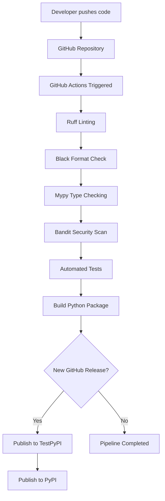

# 🐍 Python Projects: CI/CD

**A hands-on Python project focused on implementing modern CI/CD practices using GitHub Actions and industry-standard Python development tools.**

This repository is part of my **Python for DevOps** course, where I explore how to automate code quality checks, testing, building, and package publishing through Continuous Integration and Continuous Delivery (CI/CD).

---

## 📌 Table of Contents

- [About the Project](#-about-the-project)
- [Project Objectives](#-project-objectives)
- [Technologies & Tools](#-technologies--tools)
- [CI/CD Pipeline](#-cicd-pipeline)
- [Project Structure](#-project-structure)
- [Getting Started](#-getting-started)
- [Running Quality Checks](#-running-quality-checks)
- [Running Tests](#-running-tests)
- [Building the Package](#-building-the-package)
- [Publishing](#-publishing)
- [Learning Outcomes](#-learning-outcomes)

---

## 🚀 About the Project

The goal of this repository is to build a Python project and progressively implement a complete CI/CD pipeline.

Using GitHub Actions, we automate the development lifecycle, from code validation to package distribution.

The project demonstrates how DevOps principles can be applied to Python development to improve:

- Code quality and consistency.
- Application reliability.
- Development workflow automation.
- Security and maintainability.
- Software delivery and deployment.

## 🎯 Project Objectives

The following tasks represent the main milestones of this project:

- [ ] **Project Implementation** – Develop the Python application and its core functionality.
- [ ] **GitHub Actions Workflow** – Create a basic GitHub Actions workflow and ensure it runs successfully from start to finish.
- [ ] **Linting & Formatting** – Integrate Ruff for linting and Black for code formatting checks.
- [ ] **Static Typing** – Configure Mypy to validate Python type annotations.
- [ ] **Security Analysis** – Integrate Bandit to identify potential security vulnerabilities.
- [ ] **Automated Testing** – Implement automated tests and execute them through CI.
- [ ] **Package Building** – Configure the project to build distributable Python packages.
- [ ] **Automated Publishing** – Publish the package to TestPyPI and PyPI whenever a new GitHub release is published.

## 🛠️ Technologies & Tools

| Tool | Purpose |
|---|---|
| Python | Main programming language |
| Git & GitHub | Version control and collaboration |
| GitHub Actions | CI/CD automation |
| Ruff | Python linting |
| Black | Code formatting |
| Mypy | Static type checking |
| Bandit | Security analysis |
| Pytest | Automated testing |
| Build | Python package building |
| TestPyPI | Test package distribution |
| PyPI | Production package distribution |

## ⚙️ CI/CD Pipeline

The GitHub Actions pipeline will automate the following stages:



The objective is to ensure that every change is validated automatically before the package is distributed.

## 📂 Project Structure

```text
python-projects-cicd/
│
├── .github/
│   └── workflows/
│       ├── python.yml
│       └── publish.yml
│
├── src/
│   └── your_package/
│       ├── __init__.py
│       └── main.py
│
├── tests/
│   └── test_main.py
│
├── pyproject.toml
├── README.md
├── LICENSE
└── .gitignore
```

*The structure may evolve as the project develops.*

## 💻 Getting Started

### Prerequisites

Make sure you have the following installed:

- Python 3.10 or higher.
- Git.
- pip.
- A GitHub account.

### 1. Clone the repository

```bash
git clone https://github.com/YOUR_USERNAME/python-projects-cicd.git

cd python-projects-cicd
```

### 2. Create a virtual environment

```bash
python -m venv .venv
```

Activate it:

**Linux / macOS**

```bash
source .venv/bin/activate
```

**Windows**

```bash
.venv\Scripts\activate
```

### 3. Install dependencies

```bash
pip install -e ".[dev]"
```

## 🔍 Running Quality Checks

Run the following commands locally to validate the code.

### Ruff – Linting

```bash
ruff check .
```

### Black – Formatting

```bash
black --check .
```

To automatically format the code:

```bash
black .
```

### Mypy – Type Checking

```bash
mypy src/
```

### Bandit – Security Checks

```bash
bandit -r src/
```

## 🧪 Running Tests

Execute the automated test suite using Pytest:

```bash
pytest
```

Generate a test coverage report (if pytest-cov is configured):

```bash
pytest --cov=your_package
```

## 📦 Building the Package

Build the Python distribution packages using the `build` module:

```bash
python -m pip install build
python -m build
```

This generates:

```text
dist/
├── your_package-0.1.0.tar.gz
└── your_package-0.1.0-py3-none-any.whl
```

## 🚀 Publishing to TestPyPI & PyPI

The final objective is to automate package publishing through GitHub Actions.

Whenever a new GitHub release is published, the workflow will:

1. Build the Python package.
2. Publish the package to **TestPyPI**.
3. Publish the package to **PyPI**.

For secure publishing, GitHub Actions will use **Trusted Publishing (OIDC)** rather than storing long-lived API tokens whenever supported.

**Package registries:**

- 🧪 [TestPyPI](https://test.pypi.org/)
- 📦 [PyPI](https://pypi.org/)

> Note: TestPyPI and PyPI are independent package registries. Package names and versions must be available on each registry before publishing.

## 📚 Learning Outcomes

By completing this project, I aim to gain practical experience with:

- Building and structuring Python packages.
- Implementing CI pipelines with GitHub Actions.
- Automating linting, formatting, and type checking.
- Integrating security scanning into development workflows.
- Running automated tests.
- Building Python distributions.
- Automating package releases and publishing.
- Applying DevOps best practices to Python projects.

---

⭐ **If you find this repository useful, feel free to star it!**

*Built with Python, automated with GitHub Actions, and inspired by DevOps best practices.*